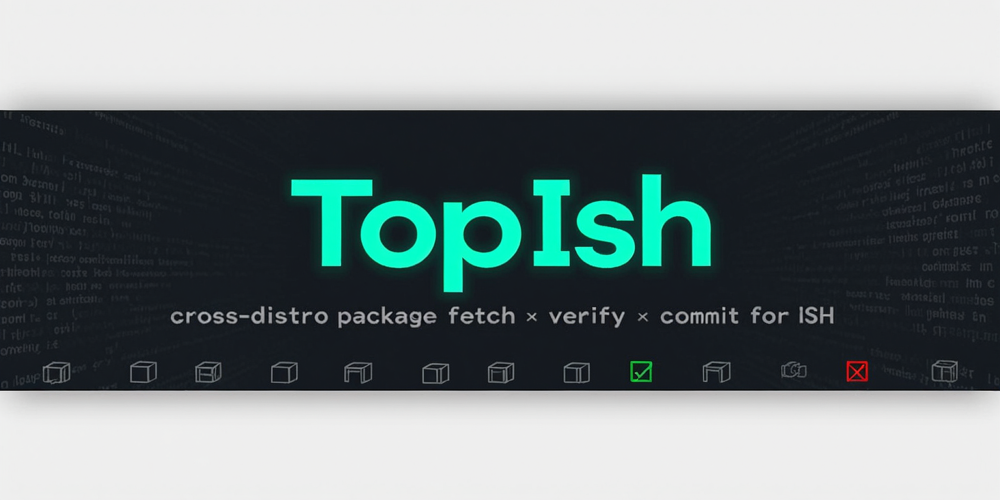

<div align="center">
  
  <h1>TopIsh</h1>
  <p><b>Cross-distro package fetch · verify · commit for iSH.</b><br>
  Downloads packages from Alpine, Debian, Void, Arch32, Kali and more — then <i>proves they run</i> before a single byte lands in <code>/usr</code>.</p>

  
  
  
  
</div>

---

## What this is

iSH is an x86 Alpine rootfs emulated on iOS. Its own `apk` is fine — but it can only see Alpine. TopIsh is a second front door for people who want a specific tool that only exists in Debian, Kali, Void or Arch32 repos, and who don't want to discover it's broken *after* it's installed into `/usr`.

Every install runs seven gates against a staging tree. Fail a gate, and the tree is thrown away. Pass all seven, and you get a commit prompt plus an exact `remove` line.

```
┌ TopIsh 0.2.0 ─────────────────────────────┐
│ iSH i686 · musl · 412 MiB free            │
└───────────────────────────────────────────┘
  install nmap from kali/i386
  tier: gcompat
  ──────────────────────────────────────────

  [1/7] source  kali/nmap                    7.94
  [2/7] fetch   nmap_7.94-0kali1_i386.deb    ok
  [3/7] unpack  214 files                    ok
  [4/7] arch    ELF machine check            ok
  [5/7] libc    interp + DT_NEEDED           ok
  [6/7] smoke   run under 5s timeout         ok
      Nmap version 7.94 ( https://nmap.org )
  [7/7] space   3480 KiB staged              ok
  ──────────────────────────────────────────
  | PASS all gates · rollback armed          |
  commit? [y/N]
```

## What this is not

- Not an `apt`/`pacman`/`xbps` clone. No dependency graph solving — gate 5 reports missing libs, you resolve them.
- Not a package builder. It installs other distros' binaries.
- Not a sandbox. `commit` copies into `/` with your permissions.

## The arch problem, stated plainly

iSH executes **32-bit x86 only**, on **musl**. Sources are tiered by how well that survives contact:

| Tier | Sources | Result |
| :-- | :-- | :-- |
| 🟢 **native** | `alpine` `alpine-edge` `void` | musl x86, installs cleanly |
| 🟡 **gcompat** | `debian` `devuan` `ubuntu` `kali` `parrot` `arch32` `slackware` | glibc x86, needs `gcompat`, expect gate 5 failures |
| 🟠 **legacy** | `opensuse` `fedora-archive` | frozen snapshots (2019–2023), best-effort |
| 🔴 **noexec** | `termux` `raspios` | ARM — fetchable and inspectable, won't execute |

`termux` is the one everyone asks for and the one that can't work: its packages are `aarch64`/`arm`. There is no translation layer in iSH. You can still stage a Termux package to read its scripts and layout.

## Install

```sh
apk add curl binutils            # fetch + ar + readelf
git clone https://github.com/<you>/topish
install -m755 topish/bin/topish /usr/local/bin/topish

topish doctor                    # what your box can and can't do
```

Optional extractors, only needed for the formats that use them:

```sh
apk add zstd xz rpm2cpio cpio    # zst/xbps, txz, rpm
apk add gcompat                  # glibc binaries at all
```

## Usage

```sh
topish sources                          # the tier table
topish search nmap kali                 # index search
topish install jq --from alpine         # native, trivial
topish install gcompat --from alpine    # prerequisite for tier 2
topish install nmap --from kali --dry-run
topish install nmap --from kali         # gates, then prompt
topish list
topish remove nmap                      # exact file-list rollback
```

| Flag | Effect |
| :-- | :-- |
| `--from <src>` | source (default `alpine`) |
| `--dry-run` | run all gates, keep the tree, commit nothing |
| `--no-test` | skip gate 6 |
| `-y` / `--yes` | no commit prompt |

| Env | Default | Meaning |
| :-- | :-- | :-- |
| `TOPSH_MAX_BYTES` | `26214400` | per-package download cap (25 MiB) |
| `TOPSH_TEST_TIMEOUT` | `5` | seconds per smoke attempt |
| `TOPSH_ROOT` | `~/.topish` | state, cache, staging |
| `TOPSH_WIDTH` | auto | force UI width |

## How the gates work

| # | Gate | Rejects when |
| :-- | :-- | :-- |
| 1 | source | package absent from the index |
| 2 | fetch | download fails or exceeds budget |
| 3 | unpack | archive corrupt; also prunes docs/man/locale and strips binaries |
| 4 | arch | `e_machine` isn't `EM_386` |
| 5 | libc | glibc interp without `gcompat`, or any unresolved `DT_NEEDED` |
| 6 | smoke | binary exits >1, segfaults, or reports missing symbols under `timeout` |
| 7 | space | staged tree is absurd relative to the download |

Gate 6 tries `--version`, `-version`, `-V`, `-h`, `--help`, then bare invocation, and accepts the first clean exit. glibc binaries are launched through `/lib/ld-linux.so.2 --library-path <stage>` rather than the normal loader path, which is what makes tier 2 testable at all.

## Space discipline

- `usr/share/{doc,man,info,locale,gtk-doc}` deleted at unpack
- `.la` files deleted
- executables `strip`ped when `strip` exists
- 25 MiB hard cap, checked before the download completes
- one shared staging dir, wiped per install — no accumulating trash
- indexes cached 24h in `~/.topish/cache`, never in the repo

## Limitations

- **Tier 2 is a coin flip.** Many Debian/Kali tools fail gate 5 on glibc symbol versioning that `gcompat` doesn't cover. Python-based Kali tools pull 200+ deps and usually lose.
- **No dependency resolution.** Gate 5 tells you what's missing; you stage it yourself.
- **`ar`, `cpio`, `rpm2cpio`, `zstd` are separate installs**, and gate 3 dies with the `apk add` line if one is absent.
- **First deb/rpm lookup downloads a multi-MB index.** Slow, one-time per suite per 24h.
- **Search works for `apk` and `deb` only.** Others: try `topish install <pkg> --from <src>` directly.
- **`parrot` and `opensuse` i386 coverage is spotty** and may return nothing on current suites.
- Package signing is not verified. Everything is HTTP(S) fetch, trusted as delivered.

## Adding a source

One case in `src_meta`, one lookup function, one line in the `resolve` dispatch:

```sh
newsrc) echo "gcompat|i386|deb|https://host/dists/suite" ;;
```

`base` is the path up to and including `dists/<suite>`; `resolve` derives the repo root from it. Kinds: `apk` `deb` `zst` `xbps` `txz` `rpm`. New kinds need a case in `need_for` and `unpack`.

## Repo layout

```
topish/
├── bin/topish          # the whole thing, one POSIX sh file
├── assets/banner.png
├── docs/SOURCES.md     # per-source notes and known breakage
├── LICENSE
└── README.md
```

## Contributing

Most useful contributions, in order:

1. **A dependency manifest resolver** for gate 5 — auto-stage missing libs from the Alpine i386 repo instead of just reporting them.
2. **`~/.topish/tests.d/<pkg>.sh` hook** so a package ships its own smoke command.
3. A real screenshot / GIF of the TUI for this README.
4. Source cases with evidence that gate 5–6 pass on them.

Open an issue with the `topish install … --dry-run` transcript before a PR that touches the gates.

## License

MIT — see [LICENSE](LICENSE).

Not affiliated with Alpine, Debian, Void, Arch Linux 32, Kali, Termux or iSH. Packages belong to their respective distros; check their licences before redistributing binaries.
